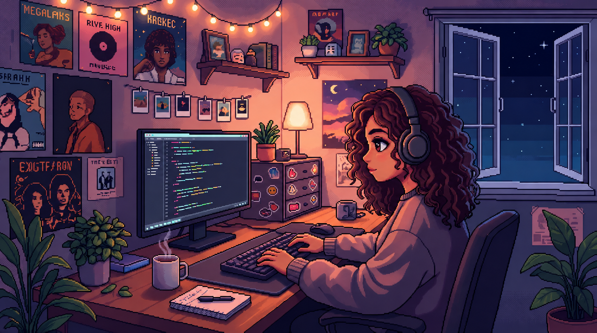

<!-- ═══════════════ HEADER ═══════════════ -->
<div align="center">

<a>
  
</a>
`⏮` &nbsp; `▶` &nbsp; `⏭` &nbsp;&nbsp; ▁ ▃ ▅ ▇ ▅ ▃ ▁ ▃ ▅ ▇ ▅ ▃ ▁

</div>

<br>

<!-- ═══════════════ ABOUT ═══════════════ -->

## 🎧 &nbsp;Liner Notes

```text
ARTIST   : Rashi Johari
ALBUM    : B.Tech CSE @ JIIT Noida (2024 – 2028)
GENRE    : Full-stack · Computer vision · Late-night lo-fi
FEATURING: Headphones, chai, and one more bug fix
```

<br>

## 🎸 &nbsp;The Instruments

<div align="center">

**Languages**


**Frontend**


**Backend & Database**


**AI / Tools**


</div>

<br>

## 💿 &nbsp;Tracklist

| # | Track | The vibe |
| :-: | :--- | :--- |
| 01 | **🔒 Locked-In** | A minimalist student planner, built as a PWA |
| 02 | **🌍 The Parallel** | Historical analogies for today's news, reasoned by AI |
| 03 | **🔎 Lecture Lens** | AI-powered tool to extract and summarize whiteboard notes from classes |

<br>

## 📻 &nbsp;Request a Song

<div align="center">

<a href="mailto:rashijohari17@gmail.com">

</a>

<br><br>

<sub>♪ *Thanks for listening. Press play again anytime.* ♪</sub>


</div>
